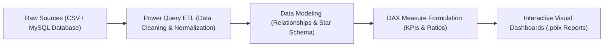

# 📊 Business Analytics & Power BI Practical Laboratory

<p align="center">
  
</p>

<p align="center">
  A comprehensive laboratory repository of 5 practical business analytics experiments in <b>Microsoft Power BI Desktop</b>, covering database connections, multi-source ingestion, Power Query data transformation, DAX formula calculations, and executive reporting.
</p>

<p align="center">
  <a href="https://github.com/prakruthidevanga/Business-Analytics">
    
  </a>
</p>

<p align="center">
  
  
  
  
</p>

---

## 📌 Table of Contents

- [📖 Project Overview](#-project-overview)
- [🎯 Objectives](#-objectives)
- [🔬 Laboratory Experiment Index](#-laboratory-experiment-index)
- [🏗️ Power BI Data Pipeline](#️-power-bi-data-pipeline)
- [🛠️ Technology Stack](#️-technology-stack)
- [📁 Repository Structure](#-repository-structure)
- [⚙️ How to View & Explore](#️-how-to-view--explore)
- [🔮 Future Enhancements](#-future-enhancements)
- [🤝 Contributing](#-contributing)
- [👩‍💻 Author & Accreditations](#-author--accreditations)

---

## 📖 Project Overview

Modern enterprises depend on analysts capable of handling messy, unstructured transactional data across heterogeneous database systems and converting it into executive dashboards.

This repository captures **5 structured laboratory experiments** completed in the Department of Computer Applications at Alliance University. Covering flat CSV files, MySQL relational databases, dirty cafe datasets, and Superstore retail catalogs, the experiments explore data ingestion, Power Query transformation, DAX KPI formulas, and executive visualizations.

📊 **Core Mission:** Master end-to-end business intelligence pipelines from raw transactional database extraction to finished executive dashboards.

---

## 🎯 Objectives

- 🔌 **Heterogeneous Data Ingestion:** Connect Power BI to MySQL relational tables and local CSV flat files.
- 🧹 **Advanced Power Query Cleansing:** Normalize unstructured cafe receipts, unpivot attributes, and remove anomalous records.
- 🧮 **DAX KPI Modeling:** Formulate custom measures for Profit Margins, Total Units Sold, and Average Order Values.
- 📊 **Interactive Report Creation:** Implement dynamic date slicers, custom rankings, and decomposition trees.

---

## 🔬 Laboratory Experiment Index

| Experiment # | Dataset & Topic | Deliverables & Dashboard |
| :-: | :--- | :--- |
| **Exp 1** | Importing Business Datasets from Flat File & MySQL Database | Schema connection guide and `Retail_Sales_Perfromance_expre1.pbix` |
| **Exp 2** | Superstore Sales Performance Analysis | Regional performance mapping and `Superstore Sales perforamnce (BA Ex 2).pbix` |
| **Exp 3** | Retail Sales & Profit Performance Dashboard | Margin realization measures and `Retail_Sales_&_Profit_Perfromance_expre3.pbix` |
| **Exp 4** | Data Cleaning & Transformation of Cafe Sales | Advanced Power Query ETL and `Cafe Sales - Dirty Data for Cleaning.pbix` |
| **Exp 6** | Sorting and Filtering Data in Power BI | Dynamic visual interactions and `Sales_Data.pbix` |

---

## 🏗️ Power BI Data Pipeline



---

## 🛠️ Technology Stack

<p align="center">
  
</p>

| Component | Technology | Implementation Details |
| :--- | :--- | :--- |
| **BI Platform** | Microsoft Power BI Desktop | Data modeling, interactive reports, visual container design |
| **ETL Engine** | Power Query (M Language) | Dirty data transformation, column pivoting, null handling |
| **Formulas** | DAX | Time-intelligence aggregations and ratio calculations |
| **Data Sources** | MySQL & CSV Datasets | Transactional sales, customer profiles, product tables |

---

## 📁 Repository Structure

```text
Business-Analytics/
├── Experiment No.: 1/   # MySQL and CSV ingestion documentation and .pbix
├── Experiment No.: 2/   # Superstore sales performance analysis and .pbix
├── Experiment No.: 3/   # Retail profit margin dashboard and .pbix
├── Experiment No.: 4/   # Cafe sales dirty data cleaning guide and .pbix
├── Experiment NO.: 6/   # Sorting and dynamic filtering dashboard and .pbix
└── README.md            # Comprehensive project documentation
```

---

## ⚙️ How to View & Explore

1. Install [Microsoft Power BI Desktop](https://powerbi.microsoft.com/desktop/).
2. Clone this repository:
   ```bash
   git clone https://github.com/prakruthidevanga/Business-Analytics.git
   cd Business-Analytics
   ```
3. Open any `.pbix` dashboard file to explore the transformations, model schemas, and DAX measures!

---

## 🔮 Future Enhancements

- 🌐 **Power BI Service Deployment:** Publish dashboards to cloud workspaces with scheduled automatic dataset refreshes.
- 📈 **Statistical Outlier Detection:** Integrate R or Python scripts within Power Query for automated anomaly flagging.

---

## 🤝 Contributing

Contributions and lab variations are welcome!

---

## 👩‍💻 Author & Accreditations

**Prakruthi B R**  
*BCA Student specializing in Artificial Intelligence & Machine Learning*  
*Alliance University, Bengaluru (CGPA: 9.60)*  
*GeeksforGeeks Campus Mantri (2026)*

- 💻 **GitHub:** [@prakruthidevanga](https://github.com/prakruthidevanga)
- 🔗 **LinkedIn:** [Prakruthi BR](https://linkedin.com/in/prakruthi-br)
- 🌐 **Portfolio:** [prakruthidevanga.github.io](https://prakruthidevanga.github.io/)
- 📬 **Email:** [prakruthibr2006@gmail.com](mailto:prakruthibr2006@gmail.com)

---

<p align="center">
  <b>📊 Empowering business decisions with rigorous data transformation and visual analytics.</b>
</p>

<p align="center">
  
</p>
