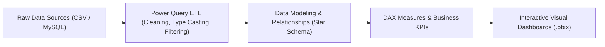

# 📊 Business Analytics & Power BI Practical Laboratory

A comprehensive repository of interactive business intelligence dashboards, Power Query data transformation workflows, DAX KPI formulas, and formal analytical experiment reports completed at Alliance University.

---

## 📌 Repository Overview

This repository captures practical business analytics exercises using **Microsoft Power BI Desktop**, connecting flat files (CSV), MySQL relational databases, and enterprise data models to generate actionable commercial insights.

### Key Competencies Demonstrated:
- **Data Ingestion & Connectors:** Importing multi-source business datasets from CSV files and MySQL databases into Power BI.
- **Data Cleansing with Power Query:** Handling dirty unstructured sales data (e.g., Cafe sales), unpivoting columns, data type normalization, and handling missing transaction values.
- **DAX & KPI Modeling:** Authoring Data Analysis Expressions (DAX) for Profit Margin, Revenue Growth Rate, Total Units Sold, and Average Order Value (AOV).
- **Interactive Report Design:** Implementing slicers, drill-through filters, decomposition trees, and visual sorting for executive reporting.

---

## 📂 Laboratory Experiments & Report Index

| Experiment # | Topic & Dataset | Analytical Deliverables |
| :-: | :--- | :--- |
| **Exp 1** | `Importing Business Datasets from Flat File & MySQL` | Database connection pipeline, schema import, and `Retail_Sales_Perfromance_expre1.pbix` |
| **Exp 2** | `Superstore Sales Performance Analysis` | Regional sales trends, category contribution analysis, and `Superstore Sales perforamnce (BA Ex 2).pbix` |
| **Exp 3** | `Retail Sales & Profit Performance Dashboard` | Margin analysis, profit realization KPIs, and `Retail_Sales_&_Profit_Perfromance_expre3.pbix` |
| **Exp 4** | `Data Cleaning & Transformation of Cafe Sales` | Advanced Power Query ETL, dirty data cleaning, and `Cafe Sales - Dirty Data for Cleaning Training Ex 4.pbix` |
| **Exp 6** | `Sorting and Filtering Data in Power BI` | Dynamic visual interactions, custom rankings, and `Sales_Data.pbix` |

---

## 🏗️ BI Analytics Pipeline



---

## ⚙️ How to View & Explore

1. Download and install [Microsoft Power BI Desktop](https://powerbi.microsoft.com/desktop/).
2. Clone this repository:
   ```bash
   git clone https://github.com/prakruthidevanga/Business-Analytics.git
   cd Business-Analytics
   ```
3. Open any `.pbix` file (e.g. `Retail_Sales_&_Profit_Perfromance_expre3.pbix`) in Power BI Desktop to interact with the visualizations, inspect Power Query transformations, and view the DAX formula definitions!

---

## 🛠️ Technology Stack

- **BI & Analytics:** Microsoft Power BI Desktop, Power Query M language, DAX (Data Analysis Expressions)
- **Databases:** MySQL, CSV flat files
- **Reporting:** Formal PDF lab experiment reports

---

## 👩‍💻 Author & Contributions

- **Author:** Prakruthi B R ([@prakruthidevanga](https://github.com/prakruthidevanga))
- **Program:** BCA (Specialization in Artificial Intelligence and Machine Learning), Alliance University.
- **Contributions:** Designed all 5 Power BI interactive dashboards, built custom DAX measures, performed ETL in Power Query, and authored laboratory experiment documentation.
